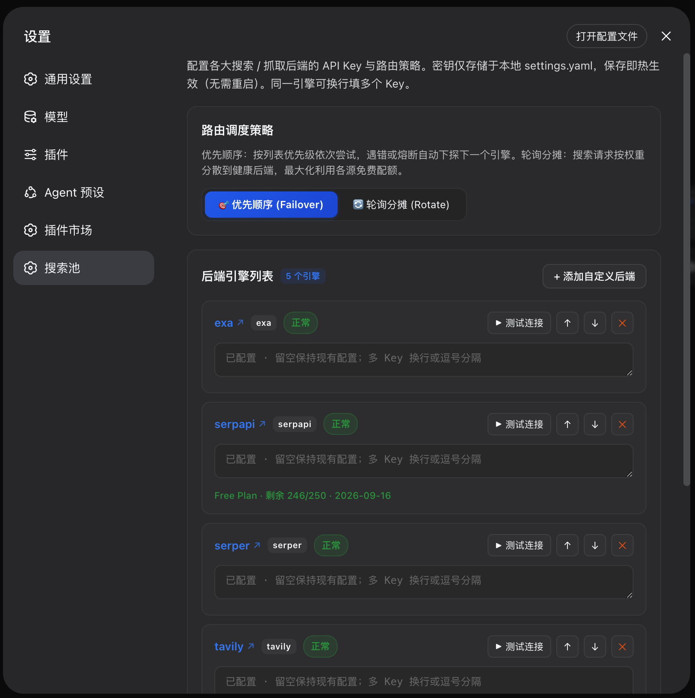
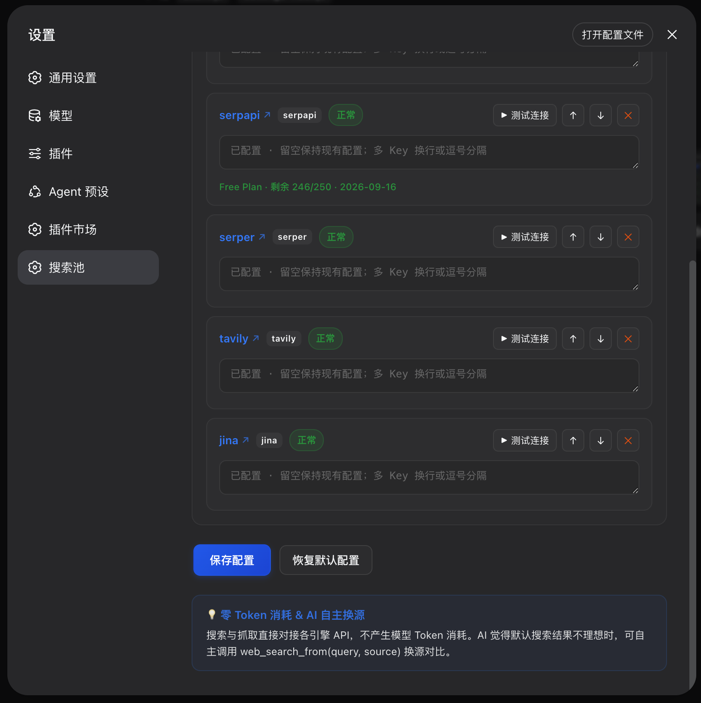

# dsh-search-failover

<p align="center">
  <a href="https://www.npmjs.com/package/dsh-search-failover"></a>
  <a href="https://github.com/Walvez/dsh-search-failover/actions/workflows/test.yml"></a>
  <a href="https://nodejs.org/"></a>
  <a href="https://github.com/Walvez/dsh-search-failover/blob/main/LICENSE"></a>
  <a href="https://github.com/deepseek-ai/awesome-dsh-plugin"></a>
</p>

<p align="center">
  <b>DeepSeek Harness (DSH) 原生 provider 级智能搜索 / 抓取池</b><br>
  直连检索端点，模型 Token = 0 · 多源容灾 · 加权轮询 · 额度感知熔断 · AI 自主换源 · 现代卡片流 Web GUI
</p>

<p align="center">
  
</p>

---

## 为什么不用官方默认搜索？

DSH 默认通道 `deepseek-official` **不是专用搜索 API**：每次 `web_search` 都会发起一轮完整 Messages 模型调用，由 DeepSeek 在服务端执行搜索。这意味着：

| | 官方 `deepseek-official` | 本插件 `search-pool` |
|---|---|---|
| 检索方式 | 一整轮 LLM 调用 + 服务端 `web_search` 工具 | 直连 Exa / Tavily / Jina / Firecrawl 等检索端点 |
| 模型 token | 每次搜索都烧（input + output），结果还会回灌上下文 | **0**（纯检索，不碰任何 LLM） |
| 计费来源 | `DEEPSEEK_API_KEY` 余额 | 各引擎自己的免费额度 |
| 抓取 `web_fetch` | 同样走官方通道 | 同步接管：Jina Reader / Exa Contents / Tavily Extract / Firecrawl Scrape |
| 宕机 / 额度耗尽 | 整条链路挂掉 | 熔断冷却 + 自动下探下一个引擎 / 下一个 Key |

装上即把 `searchProvider` 与 `fetchProvider` 都指到 `search-pool`。卸载后自动回落到官方通道。

---

## ✨ 核心特性

- 🛡️ **Provider 级透明替换**：无侵入接管 DSH `ctx.web` 的 **搜索 + 抓取**，保持原生 `web_search` / `web_fetch` 工具签名不变。
- 🔄 **双重路由策略**：
  - **优先顺序 (Failover)**：按优先级从高到低依次尝试，前一个后端失败或熔断自动下探下一个。
  - **加权轮询 (Weighted Rotate)**：按 1~10 权重将搜索流量平摊到所有健康引擎，最大化榨干各大搜索源的免费额度。
- ⚡ **智能额度感知与熔断器 (Circuit Breaker)**：
  - 遇到额度耗尽（HTTP 402/429/Quota Exceeded）→ **长冷却 (1h)**，避免无效请求；
  - 遇到临时网络抖动（Transient Error）→ 5 分钟内连续 3 次失败触发 **短冷却 (60s)**；
  - 冷却到期自动半开探活，成功立即恢复。
- 🤖 **AI 自主换源技能 (`web_search_from`)**：
  - 为 Agent 注入专属换源工具。当 AI 认为默认结果不够理想、信息过时或源单一时，可自主选择 `exa` / `serper` / `tavily` / `jina` / `firecrawl` 等引擎重新搜索并对比。
- 🎛️ **现代卡片流 Web GUI 设置面板**：
  - 在 DSH 设置页一键填写/修改 API Key、切换策略、拖拽排序、测试连通性，**保存即实时生效，无需重启进程**。
  - 密钥安全保存在本地 `~/.dsh/settings.yaml`，绝不上报。
- 🔑 **单引擎多 Key 轮换**：同一后端可换行或逗号填多个 Key；Key A 额度耗尽先切 Key B，全部挂了才熔断下探下一个引擎。
- 🔌 **全生态适配**：
  - 搜索：**Exa**, **Serper**, **Tavily** (keyless 匿名档), **Jina**, **SerpApi**, **Firecrawl**, **SearXNG** (自托管), **DuckDuckGo**, **Brave**
  - 抓取：Jina Reader (`r.jina.ai`) · Exa Contents · Tavily Extract · Firecrawl Scrape

---

## 🏗️ 架构概览

```text
┌──────────────────────────────────────────────────────────────┐
│                    AI Agent / User Chat                      │
└──────────────┬────────────────────────────────┬──────────────┘
               │ (默认搜索 / 抓取)                │ (显式换源)
               ▼                                ▼
┌──────────────────────────────┐ ┌─────────────────────────────┐
│  原生 web_search / web_fetch  │ │  web_search_from (增强工具)   │
└──────────────┬───────────────┘ └──────────────┬──────────────┘
               │                                │
               ▼                                ▼
┌──────────────────────────────────────────────────────────────┐
│               SearchPoolProvider (search-pool)               │
│                                                              │
│  [调度决策]                                                   │
│   ├── 指定源 (source): 直连指定引擎, 不走池                      │
│   ├── Failover: 按 priority 升序依次尝试                       │
│   └── Rotate: 按 weight 展开加权轮转                           │
│                                                              │
│  [熔断与健康守护]                                              │
│   ├── CircuitBreaker 监控各后端健康度                          │
│   └── 额度耗尽(1h 冷却) / 瞬时错误(60s 冷却) / 探活恢复           │
└──────────────────────────────┬───────────────────────────────┘
                               │
   ┌──────────┬──────────┬─────┴────┬──────────┬──────────┬──────────┐
   ▼          ▼          ▼          ▼          ▼          ▼          ▼
┌─────┐    ┌──────┐   ┌──────┐   ┌──────┐   ┌─────────┐┌─────┐   ┌─────────┐
│ Exa │    │Serper│   │Tavily│   │ Jina │   │Firecrawl││Serp-│   │ SearXNG │
│     │    │ .dev │   │(Anon)│   │  AI  │   │ .dev    ││ Api │   │ (Local) │
└─────┘    └──────┘   └──────┘   └──────┘   └─────────┘└─────┘   └─────────┘
```

---

## 🎛️ 设置面板实机预览

<div align="center">
  
  &nbsp;
  
</div>

- **实时密钥填写**：随时填写或更新各引擎 API Key（支持多行多 Key），点击保存立即热生效。行内「↗」直达各引擎申请页。
- **网页抓取接管**：`web_fetch` 同步走搜索池（Jina Reader / Exa / Tavily / Firecrawl），享受同一套熔断与多 Key。
- **一键测试连接 (▶ 测试)**：对指定后端发起 1 条测试搜索，毫秒级反馈连通状态与响应耗时。
- **动态优先级调整 (↑ / ↓)**：通过按钮调整引擎在 Failover 链中的优先级。
- **轮询权重调节**：在轮询分摊模式下，为不同引擎设置 1~10 权重值。
- **添加自定义后端**：无需改写代码或配置文件，直接在界面添加 SearXNG 实例或新后端。
- **额度余量透视**：行内直接显示支持额度查询的后端（如 SerpApi）的套餐类型、剩余次数及重置日期。

---

## 🚀 快速开始

### 1. 安装插件

在你的 DSH 项目或 Web Profile 下安装：

```bash
# 方式 A: 从 npm 安装 (推荐)
dsh plugin --profile web add dsh-search-failover

# 方式 B: 本地克隆软链调试 (开发者)
git clone https://github.com/Walvez/dsh-search-failover.git
dsh plugin --profile web add link:$(pwd)/dsh-search-failover
```

### 2. 启用配置

在 `cordis.patch.yml` 中声明挂载与默认后端配置：

```yaml
- id: search-pool
  name: dsh-search-failover
  config:
    strategy: failover          # failover (优先顺序) | rotate (轮询分摊)
    maxResults: 8               # 默认返回条数上限
    timeoutMs: 15000            # 单个请求超时时间 (ms)
    backends:
      - id: exa
        kind: exa
        apiKeyEnv: EXA_API_KEY  # 从 ~/.dsh/.env 读取
        priority: 1
      - id: serper
        kind: serper
        apiKeyEnv: SERPER_API_KEY
        priority: 2
      - id: tavily
        kind: tavily
        apiKeyEnv: TAVILY_API_KEY
        priority: 3
      - id: jina
        kind: jina
        apiKeyEnv: JINA_API_KEY
        priority: 4
      - id: firecrawl
        kind: firecrawl
        apiKeyEnv: FIRECRAWL_API_KEY
        priority: 5
      - id: serpapi
        kind: serpapi
        apiKeyEnv: SERPAPI_API_KEY
        priority: 6
      - id: searxng
        kind: searxng
        baseURL: http://127.0.0.1:8080
        priority: 7
      # opencodex web-search sidecar (可选, 默认不启用):
      # 本机 opencodex 代理的 Codex 登录额度执行真搜索, 结果带摘要质量最高,
      # 但比纯检索端点慢 (~3-15s)。需要本机运行 opencodex (127.0.0.1:10100)。
      # - id: opencodex
      #   kind: opencodex
      #   priority: 0              # 置顶 = 首选, 失败熔断自动下探
      #   # baseURL: http://127.0.0.1:10100
      #   # apiKey: ocx_data_dsh   # 默认免 token / 自定义 token 时填
      #   # carrierModel: opencode-go/glm-5.3-flash
    circuit:
      threshold: 3              # 连续错误阈值
      burstWindowMs: 300000     # 统计时间窗口 (5 分钟)
      cooldownMs: 60000         # 瞬时错误冷却时间 (1 分钟)
      quotaCooldownMs: 3600000  # 额度耗尽冷却时间 (1 小时)
```

### 3. 启动 DSH Web

```bash
dsh web
```

打开 Web GUI (默认 `http://127.0.0.1:3080`)，进入 **设置 → 搜索池** 即可在界面直接管理所有 Key。

### 4. DSH 版本兼容

`0.3.17+` 同时支持两代设置 API，无需按版本装不同分支：

| DSH 运行时 | 设置读写通道 | 设置面板 |
| --- | --- | --- |
| `0.2.1` 及以上 | 入口 `Config` + `settings.describe()/mutate()`（写进 profile 补丁文档） | 完整可用 |
| `0.2.0` | 旧 `settings.register()` user 层 | 完整可用（旧行为） |
| 更早 / 无 settings 服务 | 只读 `cordis.patch.yml` 行内配置 | 只能看状态，写入返回 500 并说明原因 |

在 `0.2.1+` 上请注意两点：

- **设置文档就是你的 `cordis.patch.yml`**：DSH 0.2.1 把设置写进 profile 的补丁文档本身
  （行内配置和"设置页用户层"是同一个文件）。因此面板的"恢复行内配置"不会 `unset` 字段，
  而是把 **apply 时的快照显式写回**——`unset` 会把你在文档里手写的 `backends` 一起删掉
  （实测：点一次重置，7 个后端从配置里消失）。副作用：首次从设置页保存时，该条目会被
  重新序列化，条目内的行尾注释会丢（配置值不丢）。
- **可热改的字段由 schema 决定**：本插件把 `strategy`、`backends`（含 Key / 优先级 / 权重 / 自定义后端）、
  `removed` 标记为 `volatile()`，因此这几项能在面板里改并立即生效；`timeoutMs`、`maxResults`、
  `mergeThreshold`、`circuit` 仍属组合层配置，改它们要编辑 `cordis.patch.yml` 后重启（这是有意的：
  settings 服务的默认值会把行内 `timeoutMs` 冲掉，例如 opencodex 侧车需要 40s+ 超时）。
- **需要 `@deepseek-ai/schemastery >= 3.18.5`**（`.volatile()` 从该版本才有）。若宿主自带更低的版本，
  插件会打印 `schemastery 缺少 .volatile()` 警告并退化为"只用行内配置"，面板不可用。

---

## 📊 后端引擎支持与额度参考

| 引擎标识 (`kind`) | 搜索 | 抓取 | 官方免费额度 (核实) | 密钥 | 申请页 |
|---|:---:|:---:|---|---|---|
| `exa` | ✓ | ✓ | 注册送 $20，每月赠 $10 | 必须 | [dashboard.exa.ai](https://dashboard.exa.ai/api-keys) |
| `serper` | ✓ | ✗ | 注册赠送 2,500 次 | 必须 | [serper.dev](https://serper.dev/dashboard) |
| `tavily` | ✓ | ✓ | 每月 1,000 credits；无 key 走匿名档 | 可选 | [app.tavily.com](https://app.tavily.com) |
| `jina` | ✓ | ✓ | 免费注册 Key；`s.jina.ai` 搜索 / `r.jina.ai` 抓取 | 必须 | [jina.ai](https://jina.ai) |
| `firecrawl` | ✓ | ✓ | 每月 1,000 credits | 必须 | [firecrawl.dev](https://www.firecrawl.dev/app/api-keys) |
| `serpapi` | ✓ | ✗ | 每月 250 次，支持实时额度查询 | 必须 | [serpapi.com](https://serpapi.com/manage-api-key) |
| `searxng` | ✓ | ✗ | 自托管无限 | 无 | [docs.searxng.org](https://docs.searxng.org) |
| `brave` | ✓ | ✗ | 需绑卡 | 必须 | [brave.com/search/api](https://brave.com/search/api/) |
| `ddg` | ✓ | ✗ | 完全免费 | 无 | — |
| `opencodex` | ✓ | ✗ | 走本机 opencodex 的 Codex 登录额度 | 无 (loopback 免 token) | [opencodex](https://github.com/bitkyc08/opencodex) |

> `opencodex` 后端默认**不启用**：仅在用户 patch 的 `backends` 里显式声明时进入搜索链。
> 它不是纯检索端点——搜索经 opencodex 的 web-search sidecar（Codex forward 登录额度）执行，
> 结果带模型整合的摘要与 sources，质量最高但延迟更高（sidecar 整合约 3–15s）。
> 适合置顶做首选，失败/额度耗尽由熔断器自动下探到 `exa` 等纯检索后端。

同一后端可换行或逗号填多个 Key。Key A 额度耗尽先切 Key B，全部挂了才熔断下探下一个引擎。

---

## 🤖 AI 自主换源工具 (`web_search_from`)

当 Agent 认为默认搜索结果不理想时，可以主动调用由本插件注册的 `web_search_from` 工具：

### 工具参数

```json
{
  "name": "web_search_from",
  "description": "用指定的搜索后端(引擎)搜索当前信息并返回该源原始结果。可用于多源对比或换引擎重试。",
  "parameters": {
    "query": { "type": "string", "description": "搜索关键词" },
    "source": { "type": "string", "description": "指定后端类型 (例如 exa, serper, tavily, jina, firecrawl, searxng 等)" },
    "maxResults": { "type": "number", "description": "返回结果数量上限 (默认 8)" }
  }
}
```

### Agent 典型工作流

1. Agent 执行 `web_search(query="最新技术动态")` 走默认搜索池；
2. 发现结果大多是旧闻或不相关，Agent 主动调用 `web_search_from(query="最新技术动态", source="serper")` 从 Google 实时索引获取结果；
3. 对比各源信息，输出最准确、最及时的回答。

---

## 🧪 单元测试

项目包含完善的单元测试套件（覆盖熔断器状态机、加权轮询、优先级排序、多源容灾、自愈探活等）：

```bash
# 运行单元测试
npm test

# 运行真实网络冒烟测试
EXA_API_KEY=your_key node scripts/smoke.mjs exa serper tavily
```

---

## 📄 开源许可证

本项目基于 [MIT License](LICENSE) 开源。

欢迎提交 Issue 和 Pull Request 共同改进！

---

## 📝 更新日志

### 0.3.22 (2026-10-21)

- 写回文档时去掉所有空字符串字段（含 `apiKeyEnv: ""`）：设置页保存后不会再把
  `apiKeyEnv: ""` / `weight: 1` 这类默认值刷进 profile 补丁文档。

### 0.3.21 (2026-10-21)

- **修复保存一次就丢 key 来源**：`normalizeConfig()` 重建 backend 对象时只保留固定字段，
  把 `apiKeyEnv` 抹掉了——设置页保存任意一项后，下次启动 `.env` 里的 key 全部失效。
  现在保留原对象其余字段；写回文档时也不再写入空的 `apiKey: ""` / `baseURL: ""`。
- 测试：`normalizeConfig` 保留 `apiKeyEnv` / 自定义字段。

### 0.3.20 (2026-10-21)

- **修复直写明文 key 的风险**：写路径（key 保存 / 后端增删序）原先读的是"合并后的生效配置"，
  在 DSH 0.2.1 下那份配置的 `apiKey` 已被 `.env` 解析成明文，保存一次就会把所有 key 明文写进
  git 跟踪的 profile 文档。现在写路径改读 `store.raw()`（入口原值、不经 env 解析），
  只写回 UI 真正改过的字段，`apiKeyEnv` 原样保留。
- 测试补强：`test/routes.test.js` 断言写回后 `apiKeyEnv` 仍在、且不会带入 env 明文 key。

### 0.3.18 (2026-10-21)

- **修复"恢复行内配置"会删配置**：DSH 0.2.1 的 settings 文档就是 profile 的 `cordis.patch.yml`，
  原先用 `unset` 清理用户覆盖会把用户手写在文档里的行内 `backends` 一起删掉。现在改为把
  apply 时（未经 `.env` 解析、不含明文密钥）的快照显式写回，语义变成"撤销本次运行内的设置页改动"；
  拿不到快照时直接报错而不是冒险清空。
- README 补充 0.2.1 下设置文档 = 补丁文档的注意事项；面板文案改为"恢复行内配置"。

### 0.3.17 (2026-10-21)

- **适配 DSH 0.2.1 的新设置 API**：0.2.1 移除了 `settings.register()`，设置服务改为
  "配置 schema 派生的表单 + `describe()/mutate()` 写入"。插件现在
  - 导出 `Config`（含三个 `volatile()` 字段：`strategy` / `backends` / `removed`），
  - 热读走入口 `Config` 的 volatile 引用（`config.backends.get()`），不经过 `describe()`（它会脱敏 `apiKey`），
  - 写入走 `settings.mutate(ns, [{op:'set', path:[…]}])`，带 `revision` 乐观锁并在冲突时重试一次，
  - 重置走 `unset` 路径操作回到组合层基线，
  - 命名空间取本插件 entry id（`fiber.entry.id`，可能带父级前缀，按候选列表探测），
  - 同时用 `settings.configure({auto:false})` 关掉自动生成的通用表单（避免与本插件的原生面板重复）。
- 旧 API 保留：DSH `0.2.0` 上自动走 `settings.register()` 分支，行为与 0.3.16 一致。
- 无 settings 服务时不再整块卸载 HTTP 路由：状态/额度/探测仍然可看，只有写入返回 500 并附原因。
- 修复：`mountSearchPoolRoutes` 里 `webServer` 未绑定（0.3.12 起的 `reference is not defined`）。
- 测试：新增 `test/routes.test.js`（HTTP 写路径/跨源校验/错误码）与重写的
  `test/settings-host.test.js`（volatile 引用读写、revision 冲突、双代 API 分支），共 83 个用例全绿。
